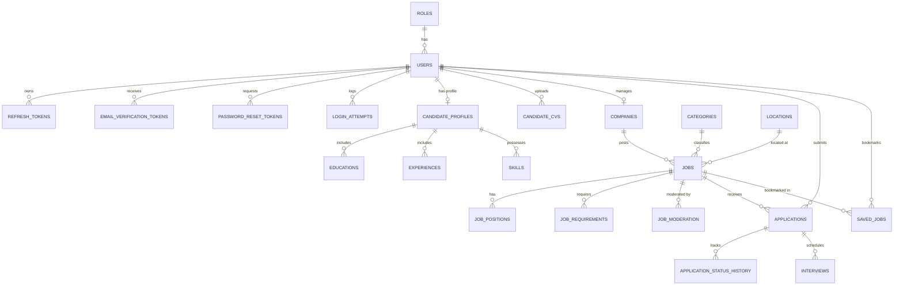

# TRIS-12: Thiết Kế Cơ Sở Dữ Liệu (ERD & Data Dictionary)

Hệ quản trị CSDL: **MySQL 8.0+ (InnoDB, charset: utf8mb4, collation: utf8mb4_unicode_ci)**

---

## 1. Sơ đồ thực thể liên kết (Mermaid ERD)

---

## 2. Các nhóm bảng chính theo Epic

### Epic 1 & 2: Xác thực & Phân quyền (Sprint 1)
1. **`roles`**: Danh mục vai trò cố định (`CANDIDATE`, `RECRUITER`, `ADMIN`).
2. **`users`**: Tài khoản người dùng (email duy nhất, password_hash, full_name, is_active, email_verified_at, last_login_at).
3. **`refresh_tokens`**: Quản lý phiên làm việc lâu dài (token_hash, user_agent, ip_address, expires_at, revoked_at).
4. **`email_verification_tokens`**: Token kích hoạt tài khoản qua email (token_hash, expires_at, used_at).
5. **`password_reset_tokens`**: Token khôi phục mật khẩu (token_hash, expires_at, used_at).
6. **`login_attempts`**: Lịch sử đăng nhập, phòng chống Brute-force.

### Epic 3: Hồ sơ ứng viên & CV (Sprint 2 & 3)
1. **`candidate_profiles`**: Thông tin cá nhân (phone, address, date_of_birth, gender, headline, summary).
2. **`educations`**: Quá trình học vấn, bằng cấp.
3. **`experiences`**: Kinh nghiệm làm việc thực tế.
4. **`skills`**: Kỹ năng chuyên môn và mức độ thành thạo.
5. **`candidate_cvs`**: Tài liệu CV tải lên (PDF, DOCX) và đánh dấu CV mặc định.

### Epic 4: Nhà tuyển dụng & Tin tuyển dụng (Sprint 2)
1. **`companies`**: Hồ sơ doanh nghiệp (name, logo_url, description, address, website).
2. **`jobs`**: Tin đăng tuyển dụng (title, description, salary_min, salary_max, job_type, deadline, status).
3. **`categories`** & **`locations`**: Danh mục ngành nghề và tỉnh/thành phố dùng chung.
4. **`job_positions`** & **`job_requirements`**: Yêu cầu kỹ năng, kinh nghiệm cho từng vị trí.
5. **`job_moderation`**: Lịch sử phê duyệt tin đăng của Admin.

### Epic 5: Ứng tuyển & Theo dõi hồ sơ (Sprint 3)
1. **`applications`**: Hồ sơ ứng tuyển nộp vào tin tuyển dụng (candidate_id, job_id, cv_id, status, cover_letter).
2. **`application_status_history`**: Nhật ký cập nhật trạng thái hồ sơ (PENDING -> REVIEWING -> INTERVIEW -> OFFERED -> REJECTED).
3. **`saved_jobs`**: Việc làm người dùng lưu lại để xem sau.
